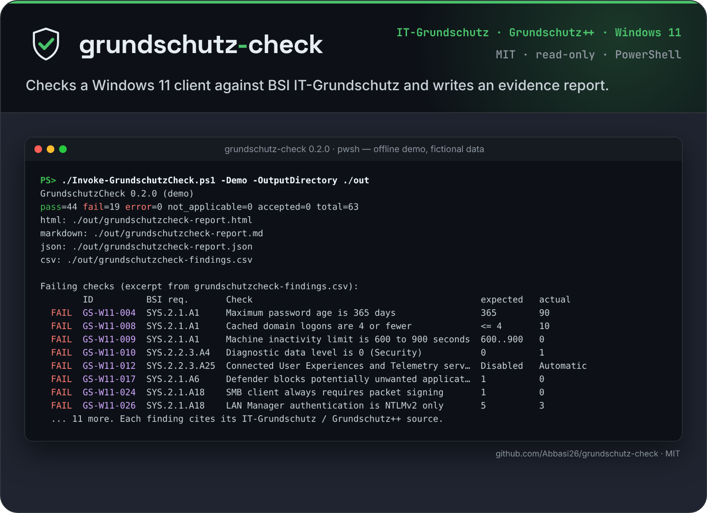

<p align="center">
  <picture>
    <source media="(prefers-color-scheme: dark)" srcset="docs/assets/logo-dark.svg">
    <source media="(prefers-color-scheme: light)" srcset="docs/assets/logo-light.svg">
    
  </picture>
</p>

<p align="center">Checks a Windows 11 client against BSI IT-Grundschutz and writes an evidence report.</p>

<p align="center">
  
</p>

# GrundschutzCheck

[](https://github.com/Abbasi26/grundschutz-check/actions/workflows/test.yml)

Read-only checks of a Windows 11 client against published BSI IT-Grundschutz and Grundschutz++ recommendations, with an evidence report.

A Windows 11 client can have diagnostic data left at "Required" (`AllowTelemetry = 1`). The BSI Hilfsmittel for Windows clients, under SYS.2.2.3.A4, recommends `0 - Security` where that value is honored, and Grundschutz++ KONF.2.4 names telemetry services as something to turn off when they are not needed. [HardeningKitty](https://github.com/scipag/HardeningKitty) ships BSI SiSyPHuS finding lists for Windows 10 1809, not a Windows 11 catalog tied to Grundschutz++ control ids. GrundschutzCheck scores that setting as `GS-W11-010`, cites both documents, and marks the Windows 11 carry-over `unverified` because BSI has not published a Windows 11 settings matrix and Microsoft does not honor value 0 on every edition.

## Quickstart

The demo uses bundled fictional evidence. It does not read the local computer and it runs on Linux.

```bash
pwsh -NoProfile -File ./Invoke-GrundschutzCheck.ps1 -Demo -OutputDirectory ./grundschutzcheck-out -Timestamp 2026-10-21T12:00:00Z
```

Exit code 1 is expected: the fictional host fails checks on purpose. Exit code 2 means a check could not be evaluated. Exit code 0 means every check passed.

Reports land in `grundschutzcheck-out/`:

- `grundschutzcheck-report.html` (self-contained)
- `grundschutzcheck-report.md`
- `grundschutzcheck-report.json`
- `grundschutzcheck-findings.csv`

The HTML report says the data is fictional. A pass is an indicator for that setting, not a certificate that the whole BSI requirement is met.

## Check a Windows computer

On Windows PowerShell 5.1 or PowerShell 7:

```powershell
pwsh -NoProfile -File .\Invoke-GrundschutzCheck.ps1 -OutputDirectory .\grundschutzcheck-out
```

Or import the module:

```powershell
Import-Module .\GrundschutzCheck.psd1
Invoke-GrundschutzCheck -OutputDirectory .\grundschutzcheck-out
```

`-Format` accepts `All`, `Html`, `Markdown`, `Json`, and `Csv`. The default is `All`.

The remote example is `examples/ansible/`. It uses `ansible.windows` to copy the module, run the same script without `-Demo`, and fetch the JSON.

## Documented exceptions (accepted risk)

Grundschutz expects a deviation to be a decision, not an oversight. Put those decisions in a JSON file and pass it with `-ExceptionPath`:

```json
{
  "exceptions": [
    { "check_id": "GS-W11-004", "reason": "Passwords do not expire by policy; length and breach screening are enforced instead.",
      "owner": "IT security officer", "expires": "2027-06-30", "ticket": "RISK-0001" }
  ]
}
```

```bash
pwsh -NoProfile -File ./Invoke-GrundschutzCheck.ps1 -Demo -ExceptionPath examples/exceptions.example.json -OutputDirectory ./grundschutzcheck-out
```

- A failing check with a current exception is reported as `accepted`, with reason, owner, expiry, and ticket in every report format. Accepted checks do not set exit code 1.
- `reason`, `owner`, and `expires` (`yyyy-MM-dd`) are required. Unknown check ids and duplicates stop the run.
- An expired exception does not hide anything: the check stays `fail` and the report says the exception expired.
- An exception never hides an `error`, and an exception for a check that now passes is listed as no longer needed.

## Compare with an earlier run

Keep the JSON report of a run and use it as a baseline next time:

```bash
pwsh -NoProfile -File ./Invoke-GrundschutzCheck.ps1 -BaselinePath ./last-month/grundschutzcheck-report.json -FailOnRegression
```

The reports get a "Changes since baseline" section: newly failing, fixed, still failing, new and removed checks, and a warning when the baseline comes from a different host fingerprint. The JSON report has the same data under `comparison`. With `-FailOnRegression` the script exits 1 only when a check newly fails, so you can adopt the catalog on an existing fleet and ratchet from there. Errors still exit 2.

## Permissions

Live collection is read-only and stays on the machine that runs it. There is no telemetry.

- Reading HKLM for the paths named in the catalog.
- A local administrator, so `secedit /export` and `auditpol /get` succeed. The export file is deleted after it is parsed. `secedit /export` reads the local security database. On a domain member, account-policy findings do not govern domain accounts. v0.1 does not query a domain controller.
- `Get-MpPreference`, `Get-WindowsOptionalFeature`, `Confirm-SecureBootUEFI`, and `Get-BitLockerVolume` for the checks that use them. If a cmdlet throws, that check is `error`, not `fail`.

`-Demo` needs none of this.

Remediation in the report is text: a Group Policy path, an Intune Settings Catalog note, and a registry or security-template snippet. v0.1 has no switch that applies them.

## Catalog

v0.1 ships 63 checks in `catalog/windows11-client.json` (schema `catalog/schema/check-catalog-0.1.schema.json`). The field guide for other tools, including a sibling project named Quorum, is [docs/catalog-schema.md](docs/catalog-schema.md).

Each check has an id, title, severity, expected value, evaluation method, remediation text, and references. Two flags are separate:

- `mapping` is `verified` or `unverified` for the link between a published requirement and the setting. Unverified links in this version are BER.6.4 (password length), BER.6.5 (password age, which conflicts with the Hilfsmittel), and DER.1.A5 (the audit requirement does not name the Windows subcategory).
- `windows11_carryover` is `unverified` on every check. The numbers come from the Hilfsmittel for Windows 10 version 21H2 and later. SYS.2.2.3 Edition 2023 covers Windows 10 and Windows 11. That is not a Windows 11 settings matrix.

Sources, read for the ids that are cited:

- [Hilfsmittel zur Umsetzung der Anforderungen des IT-Grundschutz-Kompendiums für Windows-Clients, version 1.0, 20 February 2025](https://www.bsi.bund.de/SharedDocs/Downloads/DE/BSI/Grundschutz/Hilfsmittel/Hilfsmittel_IT_Grundschutz_Windows_Client.html)
- [IT-Grundschutz-Kompendium Edition 2023](https://www.bsi.bund.de/DE/Themen/Unternehmen-und-Organisationen/Standards-und-Zertifizierung/IT-Grundschutz/IT-Grundschutz-Kompendium/it-grundschutz-kompendium_node.html)
- [Anwenderkatalog Grundschutz++, resolved catalog 2026-09-24](https://github.com/BSI-Bund/Stand-der-Technik-Bibliothek/blob/main/control_layer/Grundschutz%2B%2B/Grundschutz%2B%2B-resolved_catalog.json)

The Grundschutz++ file is not vendored. Ids and short titles are stored, with a link.

Audit policy in v0.1 scores two advanced-audit subcategories, Logon (`{0CCE9215-69AE-11D9-BED3-505054503030}`) and Credential Validation (`{0CCE923F-69AE-11D9-BED3-505054503030}`), because DET.3.1.1 says to log authentication success and failure. Those GUIDs are Windows identifiers from MS-GPAC, not BSI requirement ids. Live collection runs `auditpol /get /subcategory:{GUID} /r` for each scored subcategory and reads the CSV by column, so a German display name does not hide a pass or a fail. Inclusion settings such as `Erfolg und Fehler` and `Keine Überwachung` are stored as English. It also runs `auditpol /get /category:* /r` when that command succeeds, so the evidence section can still list subcategories that are not scored. That category-wide CSV is the fallback when a GUID query fails. The fallback accepts these de-DE names: Anmelden, Abmelden, Kontosperrung, Spezielle Anmeldung, Prozesserstellung, Benutzerkontenverwaltung, Sicherheitsgruppenverwaltung, and Anmeldeinformationen überprüfen (also Überprüfung der Anmeldeinformationen). A subcategory that is still missing is `error`, not `fail`.

Names for languages other than English and German are not in the fallback table. Those systems still match when the CSV has the subcategory GUID. The offline fixtures cover one English CSV and one German CSV. CI does not run a live de-DE Windows session, so the German display names were not re-captured from a German install in this repository.

Some Hilfsmittel rows are deliberately not scored. SmartScreen is set to Disabled there because data may leave the organisation, which is a trade-off, not a single safe expected value. MAPS has no recommended value. Password complexity is enabled for one password option and disabled for the passphrase option. "Disable all apps from Microsoft Store" is worded ambiguously in the Hilfsmittel. A firewall pass means the three profiles are on, not that an allow-list exists. A Defender pass does not prove that signatures are current, and a third-party antivirus product may turn Defender off.

## Tests

```bash
pwsh -NoProfile -Command "Invoke-Pester -CI ./tests"
python3 tools/build_catalog.py --check
python3 -m pytest tests/test_catalog.py -q
```

Pester 5.7.1 is the version used in CI. Tests mock registry and secedit input. They do not need Windows.

## How this differs from existing tools

[HardeningKitty](https://github.com/scipag/HardeningKitty) is a general Windows hardening engine and already knows how to read registry, secedit, and audit policy. Its BSI SiSyPHuS lists are for Windows 10 1809 / LTSC 2019. GrundschutzCheck does not replace it. v0.1 is a smaller, read-only checker whose catalog is tied to Kompendium requirement ids and to Grundschutz++ control ids that were confirmed in the 2026-09-24 resolved catalog, plus an evidence report with a hashed host fingerprint.

[windows_hardening](https://github.com/0x6d69636b/windows_hardening) documents Windows hardening outside the BSI catalogs. It is not a Grundschutz++ checker.

BSI's own SiSyPHuS material for hardening recommendations is the Windows 10 work, including [SiSyPHuS AP11](https://www.bsi.bund.de/DE/Service-Navi/Publikationen/Studien/SiSyPHuS_Win10/AP11/SiSyPHuS_AP11_node.html). "Windows seziert" analyses Windows 10 LTSC 2021 and Windows 11 LTSC 2024. It is not a hardening checklist, and there is no published BSI Windows 11 SiSyPHuS matrix. Grundschutz++ on [GitHub](https://github.com/BSI-Bund/Stand-der-Technik-Bibliothek) is the machine-readable catalog. It does not ship a Windows checker. v0.1 is the gap between those: a checker and a report, not a new official BSI baseline.

## Roadmap

Plan and good first issues: [ROADMAP.md](ROADMAP.md).

Not yet built:

- OSCAL Assessment Results export
- A full SiSyPHuS AP10 audit-subcategory matrix with a citation for each row
- Windows Server profiles
- Intune policy-assignment evaluation (the Intune text in the report is a snippet, not a live query)
- A preview-only switch that would apply remediation
- German report language
- Audit subcategory display names for languages other than English and German

## Contributing

See [CONTRIBUTING.md](CONTRIBUTING.md). New checks start in `tools/build_catalog.py`. Do not invent requirement ids.

## Status

Version 0.2.0, early but usable. PowerShell module `GrundschutzCheck`. MIT licensed. Every push runs the test suite in GitHub Actions (`.github/workflows/test.yml`).

## Install

```sh
Import-Module ./GrundschutzCheck.psd1
```

## License

MIT. Copyright (c) 2026 Wasaf Abbasi.

## Kurzfassung

GrundschutzCheck prüft einen Windows-11-Client nur lesend gegen ausgewählte Empfehlungen des BSI: das Hilfsmittel für Windows-Clients 1.0, das IT-Grundschutz-Kompendium Edition 2023 und bestätigte Kontrollen aus Grundschutz++. Der Demo-Befehl lautet `pwsh -NoProfile -File ./Invoke-GrundschutzCheck.ps1 -Demo -OutputDirectory ./grundschutzcheck-out`. Er erzeugt einen Bericht aus fiktiven Daten. Die konkreten Werte stammen aus dem Windows-10-Hilfsmittel und sind für Windows 11 als `windows11_carryover: unverified` gekennzeichnet. Das Werkzeug ändert keine Einstellungen und sendet keine Daten.
