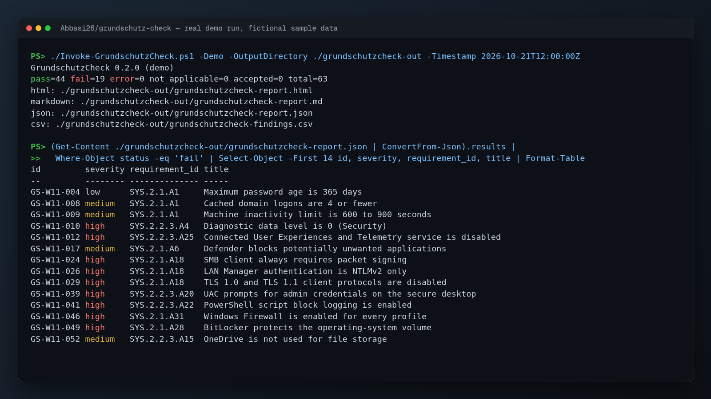

# Demo screenshot



`demo.png` (1600x900) is the unedited terminal output of a real demo run, rendered to an image on 2026-11-03. All hosts, users, devices and files in it are fictional sample data that ships with this repository. No network service or real system was involved.

Setup: PowerShell 7, from the repository root.

Commands, in the order shown in the image:

```text
PS> ./Invoke-GrundschutzCheck.ps1 -Demo -OutputDirectory ./grundschutzcheck-out -Timestamp 2026-10-21T12:00:00Z

PS> (Get-Content ./grundschutzcheck-out/grundschutzcheck-report.json | ConvertFrom-Json).results |
>>   Where-Object status -eq 'fail' | Select-Object -First 14 id, severity, requirement_id, title | Format-Table
```

Pipes such as `head`, `grep` or `sed` in the commands above only shorten the output so it fits on one screen. They are part of the shown command.
